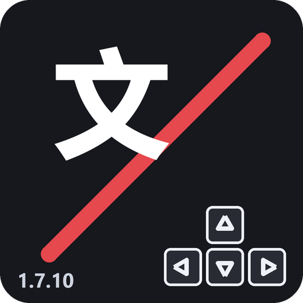

<p align="center"></p>

# IMBlocker · 1.7.10 移植版

<p align="center">    </p>

<p align="center"><b>模组仅在 GTNH 2.8.4 测试通过（Forge 10.13.4.1614 + lwjgl3ify 2.1.16 + UniMixins 0.1.23），其他版本请自测。</b></p>

> 把 [IMBlocker](https://github.com/mrjesen/ImBlockerFabric)（作者 mrjesen，Apache-2.0）的核心行为搬到 1.7.10

原版 1.7.10 的输入法一直挂在游戏窗口上，中文 / 日文 / 韩文输入法会吞掉 `W` `A` `S` `D` `E` `T` 这些按键，于是角色不动、物品栏打不开、聊天也开不出来。这个模组让键盘在「玩游戏」时保持英文直通，在「打字」时把输入法交还

```text
游戏进行中 ──┬─ 界面里没有文本框 ──► 摘除 IME ──► 按键直达游戏
             └─ 文本框拿到焦点   ──► 装回 IME ──► 正常输入中文
```

---

## 目录

- [快速开始](#快速开始)
- [行为一览](#行为一览)
- [工作原理](#工作原理)
- [配置](#配置)
- [排错](#排错)
- [兼容性与已知限制](#兼容性与已知限制)
- [从源码构建](#从源码构建)
- [项目结构](#项目结构)
- [许可与致谢](#许可与致谢)

---

## 快速开始

| 步骤 | 操作                                                             |
| -- | -------------------------------------------------------------- |
| 1  | 把 `imblocker-<version>.jar` 放进整合包的 `mods/`                  |
| 2  | 安装 **UniMixins** 前置模组                          |
| 3  | 启动游戏，主菜单后日志出现 `Using IME backend: windows/imm32 (detach)` 即为生效 |

源码与更新：<https://github.com/Lzasn/IMBlocker-1.7.10>

---

## 行为一览

| 场景                             | 输入法状态 | 说明                |
| ------------------------------ | :---: | ----------------- |
| 未打开任何界面                        |   摘除  | 走路、挖矿、快捷栏全部正常     |
| 物品栏 / 机器 GUI / 任务书 / 设置等无文本框界面 |   摘除  | `E` `Q` 等按键不再被吞   |
| 聊天栏、NEI 搜索框、GT 输入框、告示牌、书与笔     |   恢复  | 点中即恢复，无需手动切       |
| 界面关闭 / 文本框失焦                   |   摘除  | 最多晚 1 tick（50 ms） |
| 游戏窗口不在前台（Alt-Tab）              |  不处理  | 只操作自己的窗口，不影响其他程序  |

不需要任何手动切换：文本框获焦即恢复、失焦即摘除。想整体停用，把配置里 `enabled` 改成 `false` 即可（也可以直接删 jar）

---

## 工作原理

三层结构，从上到下依次是「判定 → 决策 → 系统调用」：

| 层    | 做的事              | 实现                                                           |
| ---- | ---------------- | ------------------------------------------------------------ |
| 焦点判定 | 当前界面有没有正在输入的文本框  | Mixin 注入 `GuiTextField#setFocused`（`func_146195_b`）+ 对象图扫描兜底 |
| 状态决策 | 该开还是该关，只在翻转时动作   | 每 tick（20 Hz）计算一次，幂等调用                                       |
| 系统调用 | 真正切换 Windows 输入法 | JNA 调 `imm32` / `user32`，JNA 已内嵌                             |

**① `setFocused`**  
1.7.10 生态里几乎所有文本框最后都会走到这个方法：NEI 的搜索框内部就包了一个 `GuiTextField`，AE2 的 `MEGuiTextField`、任务书、GT 的输入框也都继承自它。一条 hook 就能覆盖绝大部分场景。  
没有继承 `GuiTextField` 的自制控件，用一个「鸭子类型」扫描兜底：新界面打开时遍历一次对象图，凡是带 `isFocused()`（或 `focused` 字段）且带 `getText()` 的，都算文本输入。之后每 tick 只做几次虚调用。

**② 两种切换策略**

| 模式           | 做法                                                               | 适用                         |
| ------------ | ---------------------------------------------------------------- | -------------------------- |
| `detach`（默认） | `ImmAssociateContext(hwnd, NULL)` 把 IME 从窗口摘下来，原 HIMC 存着，打字时再装回去 | 绝大多数输入法，行为与新版 IMBlocker 一致 |
| `openstatus` | 不动关联关系，只 `ImmSetOpenStatus` 关闭 / 打开输入法                           | 少数连「摘除」都不理会的 TSF 输入法       |

装回去之后还会校验一次 `ImmGetContext`，如果 context 在摘除期间失效，会新建一个，避免出现「打字时反而完全没输入法」的死局。

**③ 窗口句柄**  
优先 `GLFWNativeWin32.glfwGetWin32Window(glfwGetCurrentContext())` —— GTNH 2.7+ 跑的是 lwjgl3ify；拿不到（比如纯 LWJGL2 的老整合）才退回 `GetForegroundWindow()`，并且核对进程 ID。

---

## 配置

`config/imblocker.cfg`，首次启动自动生成。

| 键                       | 类型     | 默认                                                   | 作用                             |
| ----------------------- | ------ | ---------------------------------------------------- | ------------------------------ |
| `enabled`               | bool   | `true`                                               | 总开关                            |
| `mode`                  | string | `detach`                                             | `detach` 或 `openstatus`，见上文策略表 |
| `checkIntervalTicks`    | int    | `1`                                                  | 每几个 tick 检查一次焦点，`1` = 50 ms    |
| `debug`                 | bool   | `false`                                              | 打印每次状态翻转与界面切换，排错用              |
| `alwaysImeScreens`      | list   | `GuiChat`、`GuiSleepMP`、`GuiEditSign`、`GuiScreenBook` | 本身没有 `GuiTextField` 但确实要打字的界面  |
| `extraTextInputClasses` | list   | 空                                                    | 额外当作输入框处理的类名（支持片段匹配）           |

<details>

<summary>展开完整配置示例</summary>

```ini
general {
    B:enabled=true
    S:mode=detach
    I:checkIntervalTicks=1
    B:debug=false

    S:alwaysImeScreens <
        net.minecraft.client.gui.GuiChat
        net.minecraft.client.gui.GuiSleepMP
        net.minecraft.client.gui.inventory.GuiEditSign
        net.minecraft.client.gui.GuiScreenBook
     >

    S:extraTextInputClasses <
     >
}
```

</details>

---

## 排错

| 现象                              | 先试这个                                                              |
| ------------------------------- | ----------------------------------------------------------------- |
| 走路时按键还是被吃                       | `mode` 改 `openstatus`，重启游戏                                        |
| 某个模组的搜索框打不出中文                   | `debug=true`，看日志里那一行 `screen -> 类名`，把类名填进 `extraTextInputClasses` |
| 聊天能打字但候选框不跟随光标                  | 这是 1.7.10 原版限制，本模组不负责；需要 IMEInputBackport / IngameIME 那类方案        |
| 启动崩溃 / 日志有 `Mixin apply failed` | 把 `logs/latest.log` 与 `crash-reports` 里的报告发出来                     |
| 想彻底关掉但保留模组                      | 配置文件 `enabled=false`                                    |

开 `debug=true` 后，日志里能看到这类信息：

```text
[IMBlocker] [debug] screen -> codechicken.nei.GuiNEIContainer (probes: 3)
[IMBlocker] [debug] IME -> on (typing)
[IMBlocker] [debug] IME -> off (playing)
```

---

## 兼容性与已知限制

| 项                                                                  | 状态                                      |
| ------------------------------------------------------------------ | --------------------------------------- |
| **GTNH 2.8.4** + lwjgl3ify 2.1.16 + LWJGL 3.3.3 + UniMixins 0.1.23 | 唯一实测通过的环境                               |
| 其他 GTNH 版本 / 其他 1.7.10 整合包                                         | 未测，请自行验证；出问题请附 `logs/latest.log`        |
| 纯 Forge 1.7.10（LWJGL2）                                             | 理论可用，窗口句柄走前台窗口兜底，未实测                    |
| Linux / macOS                                                      | 暂不支持                 |
| NEI / AE2 / 任务书 / GT 输入框                                           | Mixin 覆盖，实测点集中在 NEI 搜索框                 |
| `nech`（拼音搜索）                                                       | 不冲突：它只做搜索匹配，mixin 列表为空                  |
| 其他模组注入 `setFocused`                                                | GTNH 2.8.4全包 236 个 mod 扫描后无冲突，仅本模组注入该方法 |
| IMEInputBackport / IngameIME                                       | 会互相抢 IME 状态，建议二选一                       |
| 表情符号等代理对字符                                                         | 1.7.10 本身不支持，属原版限制                      |

其他说明：

- 只在状态**翻转**时调系统 API，不会每帧刷 `ImmAssociateContext`。
- 不使用 Mixin 的 `@Overwrite`，只做 `@Inject(HEAD)`，理论上与其他补丁共存友好。
- jar 内嵌 JNA 5.19.1（未重定位 `com.sun.jna` 包名），若整合包内另有 JNA 且版本冲突，可反馈。

---

## 从源码构建

GTNH 的新构建链对 JDK 比较挑剔：

- **跑 Gradle 必须 JDK 25**：仓库里 `gradle/gradle-daemon-jvm.properties` 写死 25，`gtnhgradle` 插件本身也要求 JVM ≥ 25；
- **`compileApiJava` 源码集要 JDK 8 工具链**：Gradle 默认会自己去 foojay / GitHub 自动下载，国内直连基本必挂。

所以本地备好 JDK 8 + 25，并显式告诉 Gradle 它们在哪：

```bash
export JAVA_HOME=/path/to/jdk-25
export JAVA_TOOL_OPTIONS="-Djavax.net.ssl.trustStoreType=WINDOWS-ROOT \
  -Dhttps.proxyHost=127.0.0.1 -Dhttps.proxyPort=7890 \
  -Dhttp.proxyHost=127.0.0.1 -Dhttp.proxyPort=7890"

./gradlew build \
  "-Dorg.gradle.java.installations.paths=/path/to/jdk8,/path/to/jdk-17,/path/to/jdk-25"
```

| 产物                                       | 用途                          |
| ---------------------------------------- | --------------------------- |
| `build/libs/imblocker-<version>.jar`     | 分发用：已 reobf（srg 名）+ 已打包 JNA |
| `build/libs/imblocker-<version>-dev.jar` | 只在开发环境 / `runClient` 使用     |

首次构建会经 GTNH Maven 拉 Forge 10.13.4.1614 + MCP `stable_12` 并反编译，约 5 分钟；之后增量构建 30 秒左右。

---

## 项目结构

```text
src/main/java/com/imblocker/backport
├── IMBlocker.java              @Mod 入口
├── CommonProxy.java            服务端空实现
├── ClientProxy.java            客户端装配、热键、关服还原
├── Config.java                 config/imblocker.cfg 读写
├── event/ClientEventHandler    ClientTick 驱动状态机
├── ime/
│   ├── ImeController           平台抽象
│   ├── ImeControllers          按操作系统选择后端
│   ├── WindowsImeController    detach / openstatus 两套策略
│   ├── Win32                   imm32 / user32 / kernel32 绑定
│   └── NoopImeController       非 Windows 兜底
├── input/
│   ├── ImeStateManager         状态机，Mixin 与 tick 的交汇点
│   ├── TextInputScanner        对象图扫描
│   └── TextInputProbe          鸭子类型包装
└── mixins/MixinGuiTextField    setFocused 注入
```

---

## 许可与致谢

- 作者：**Lzasn**（1.7.10 移植与维护）。
- 行为与思路来自 [IMBlocker](https://github.com/mrjesen/ImBlockerFabric)（mrjesen，Apache-2.0），本仓库是针对 1.7.10 的独立实现。
- 本项目同样以 **Apache-2.0** 发布，构建骨架来自 [GTNewHorizons/ExampleMod1.7.10](https://github.com/GTNewHorizons/ExampleMod1.7.10)。
- 内嵌 [JNA](https://github.com/java-native-access/jna) 5.19.1（Apache-2.0 / LGPL-2.1 双许可）。
